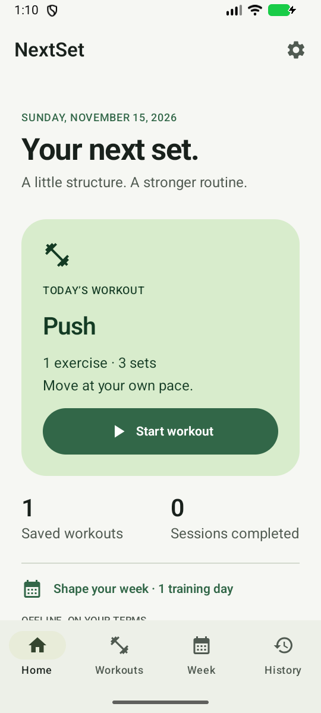
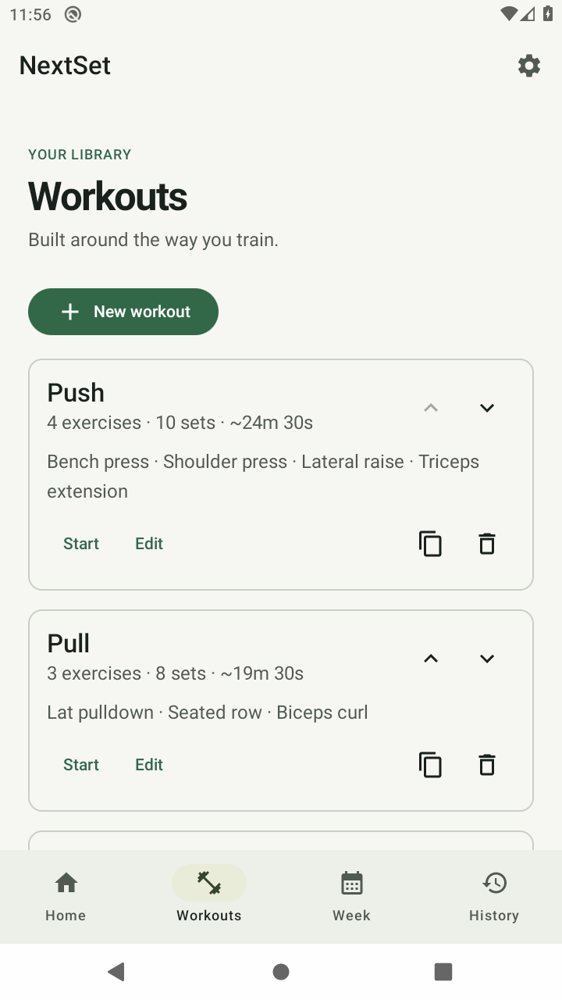
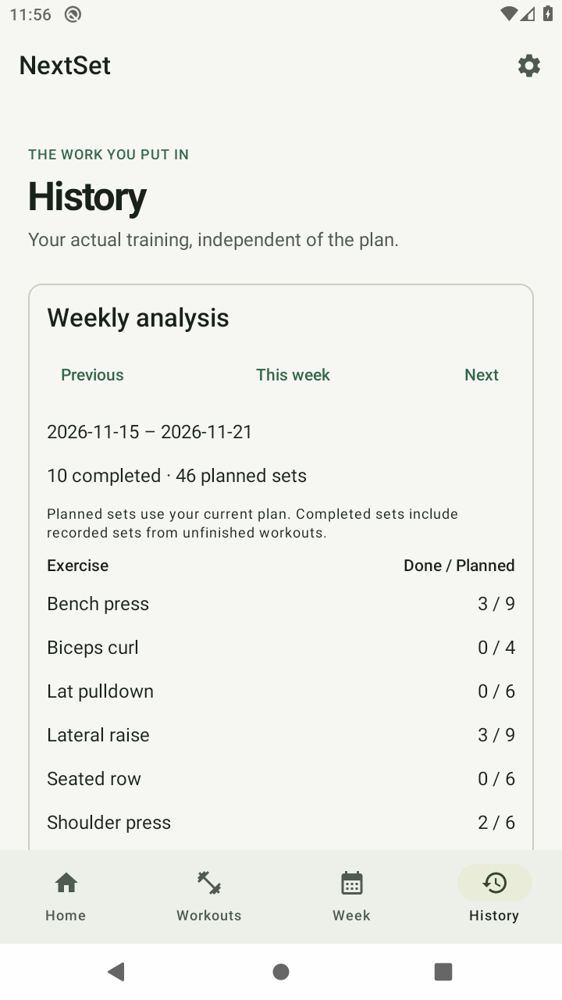
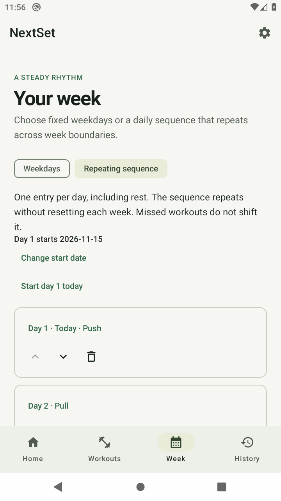
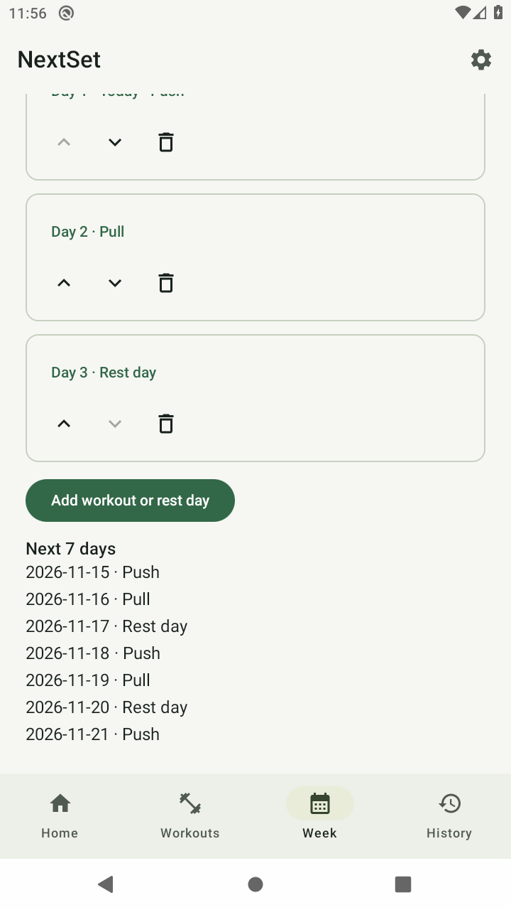
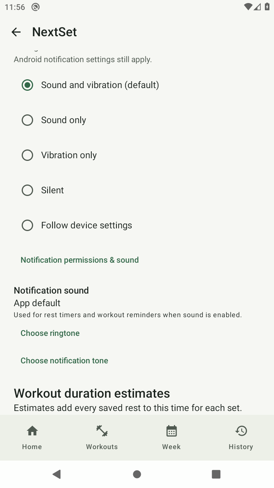
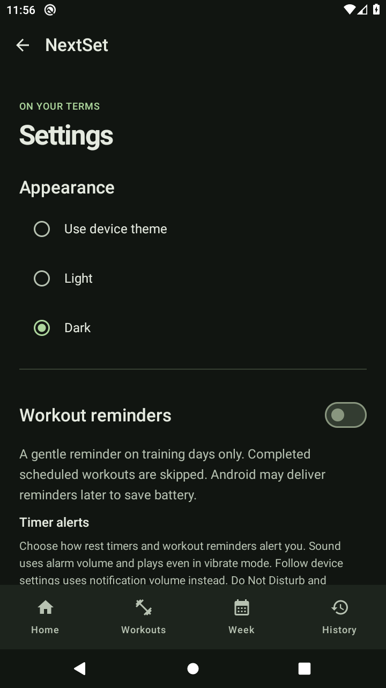
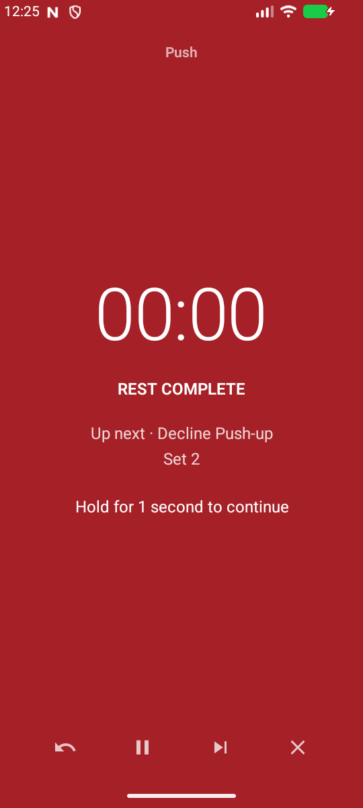

# NextSet

**A private, fully offline Android workout tracker.** Plan your week, build workouts around sets and rest, and move through them with a tap or a one-second hold. No account, ads, analytics, subscriptions or cloud services.

Android **7.0+ (API 24)** · Kotlin · Jetpack Compose · Material 3 · Room · MIT

## Features

- Unlimited workout templates with editing, duplication, deletion and accessible reorder controls.
- Exercises with individual set counts and rest overrides, including the final set and zero rest. No weight or rep forms.
- Supersets with two or more movements, unequal set counts, and separate movement, round and post-group rest defaults.
- Choose fixed weekdays or a repeating daily workout/rest sequence (such as push → pull → rest) that continues across week boundaries. Start any saved workout without shifting the plan.
- Workout summaries show exercise/set totals and estimated duration, using all configured rests plus 45 seconds per set until a workout has been completed, then the average time of its completed sessions.
- Weekly analysis in History compares planned and completed sets for each exercise, with previous/next week navigation.
- Choose a device ringtone or notification tone for rest alerts and workout reminders.
- Minimal execution: complete a set and acknowledge a finished rest with either a tap or a one-second hold (chosen separately for each in Settings; hold is the default). A deadline-based countdown turns red and waits for acknowledgment. Pause, resume, skip rest, undo and confirmed abandonment are available.
- Durable session recovery, immutable workout history, calendar/date browsing and actual completed-set records.
- Full session details: total time, how long each set took, and for each rest the timer length versus how long you actually stayed on the screen.
- Delete finished sessions (for example a trial run) from History; weekly analysis, duration averages and reminders update immediately.
- Optional adaptive or manual daily reminders; completed scheduled workouts and active sessions suppress reminders.
- Light, dark and system themes, large-text support, accessible labels/actions and adaptive/themed launcher icons.

## Screenshots

Fresh captures of the current app on an **Android 10 / API 29 emulator**, including duration estimates, both planning modes, weekly analysis, tone selection and dark theme. Workouts and completed sets are demonstration fixtures; the app ships with an empty database. The timer demonstration uses a one-second rest.

<p>  </p>
<p>  </p>
<p> </p>
<p> </p>

### Refresh the screenshots

With `adb` and Python 3 on your PATH, start a **fresh disposable emulator with no saved workouts or sessions**, then run:

```sh
./gradlew :app:assembleDebug :app:assembleDebugAndroidTest
ANDROID_SERIAL=emulator-5554 ./scripts/capture-screenshots.sh
```

The opt-in instrumentation test seeds demo workouts/history and captures the actual UI. It refuses to replace existing workout data. The script updates all 11 PNGs only after the capture test succeeds and every file passes validation. Normal test runs skip this documentation-only test. Emulator captures do not verify physical audio, vibration or manufacturer battery behavior.

## Run locally

1. Clone/download this repository and open its root folder in Android Studio.
2. Install **Android SDK Platform 37** and **Build Tools 36.0.0** through SDK Manager. Android Studio writes your ignored `local.properties` SDK path automatically.
3. Use the checked-in Gradle wrapper (**9.6**) and AGP **9.5.1**. The daemon configuration requests **JetBrains JDK 21**, which Gradle can provision automatically. The vendor requirement prevents Gradle from selecting editor runtimes that lack Android build tools such as `jlink`. App bytecode targets Java 17; core-library desugaring supports `java.time` on API 24–25.
4. Start an emulator or connect a development device with USB debugging enabled, then run:

```sh
./gradlew :app:assembleDebug
adb install -r app/build/outputs/apk/debug/app-debug.apk
adb shell am start -n com.sujoy.nextset/.MainActivity
```

Initial dependency/toolchain downloads need internet on the development machine. The installed app does not. Use a test device/emulator for development; a debug certificate cannot update an app signed with a different release certificate.

## Use NextSet

1. On first launch, select **Create your first workout**. Name it, add exercises or supersets, and adjust each movement's sets.
2. Set block rest defaults in minutes/seconds. **Customize rest for each set** overrides a default; zero skips that rest. The last set can have its own override. Use arrows to reorder blocks or superset movements, then **Save**.
3. In **Week**, choose **Weekdays** to assign fixed days, or **Repeating sequence** to add and reorder workout/rest days. Set the date for day 1; each entry takes one calendar day and the sequence repeats continuously. Missed workouts never shift either plan.
4. On **Home**, choose **Start workout**, select today's plan or any saved workout, review it, and start. Notification and precise-alarm access are optional.
5. Complete a set on the main surface; when rest turns red, confirm again to continue. By default each confirmation is a one-second hold and short taps do nothing; in **Settings → Moving forward** you can switch either step to a plain tap. Secondary controls offer undo, pause/resume, skip rest and end. Accessibility custom actions offer an alternative to holding.
6. Leaving for Home preserves the session; **Resume workout** restores it. Ending saves an abandoned session. **History** shows actual training and **Weekly analysis**, which compares planned and completed sets per exercise. Completed counts use each set’s completion date, including sets in unfinished sessions; planned counts reflect your current templates and plan. Tap a session in History to see its details: start/end, total time, each set's duration and each rest's timer length against the time you actually spent, with overruns highlighted. Paused time counts toward the step it occurred in, and sessions recorded before rest timing existed show set times that include the preceding rest (marked `*`). **Delete** removes a finished session and its records; an active session can't be deleted.
7. **Settings** controls appearance, new-block default rest and optional workout reminders. Choose automatic timing or set a manual local time. Select a ringtone or notification tone, and choose under **Moving forward** whether finishing a set and acknowledging a finished rest need a tap or a one-second hold.

Specific set overrides take priority over block defaults. Within supersets, movements with no remaining sets drop out of later rounds. Configured rest after the final workout set is retained. Rest has no product-imposed maximum; storage represents non-negative Int seconds.

## Planning and analysis

| Mode | How it repeats | Best for |
| --- | --- | --- |
| **Weekdays** | Assigned workouts repeat on the same weekdays; unassigned days are rest days. | Training on fixed days, such as Monday, Wednesday and Friday. |
| **Repeating sequence** | Each workout or rest entry takes one calendar day, then the list repeats continuously. | Push → pull → rest, without restarting the cycle every Saturday or Monday. |

In **Week → Repeating sequence**, add workouts or rest days, use the arrows to change their order, and choose **Change start date** or **Start day 1 today**. Dates before the start are unscheduled. **Next 7 days** previews the result. Switching modes keeps both plans saved. Completing, skipping or choosing a different workout does not move the calendar plan forward. A deleted workout’s sequence slot remains available to replace or remove; it is treated as rest until replaced.

**History → Weekly analysis** follows your locale’s first weekday. Use **Previous**, **This week** and **Next** to compare planned and completed sets per exercise. Planned counts use the current templates and selected planning mode, including when viewing past weeks. Completed counts come from saved session snapshots and each set’s completion date in the current timezone, including abandoned or unfinished sessions. Matching exercise names are grouped without case or surrounding-space differences; renaming an exercise creates a separate group from its old history.

Workout summaries on Home, in the library, in the workout picker and on the preparation screen show an approximate duration. Before a workout has a completed session, it is **all configured rests + total sets × 45 seconds**; afterwards it is the **average elapsed time of that workout's completed sessions** (abandoned sessions are ignored). Neither changes rest timers or limits how long a set can take. Per-set overrides, superset transitions and rest after the final set are included.

In **Settings → Notification sound**, choose from **ringtones** or **notification tones**, or restore **App default**. The selected tone applies to both rest alerts and workout reminders when sound is enabled. Sound modes use alarm volume; **Follow device settings** uses notification volume. Android’s default ringtone and notification choices follow the system setting. If a custom tone is deleted or becomes inaccessible, alerts fall back to the app defaults. Android channel settings and Do Not Disturb still apply.

## Privacy and permissions

Room and DataStore use private local app storage. There is **no INTERNET permission**. Android cloud backup and device-transfer backup are excluded. Uninstalling or clearing storage removes data; export/import is not currently available.

| Permission | Purpose | User control |
| --- | --- | --- |
| Notifications (`POST_NOTIFICATIONS`) | Rest-complete sound/vibration and daily reminders | Runtime request on Android 13+; denial never blocks training |
| Alarms & reminders (`SCHEDULE_EXACT_ALARM`) | Precise background rest deadlines | Optional special access on Android 12+; otherwise alarms may be delayed |
| Vibration (`VIBRATE`) | Notification vibration and permitted feedback | Normal permission; device/channel settings still apply |
| Boot completed (`RECEIVE_BOOT_COMPLETED`) | Restore future alarms after reboot and unlock | Normal permission; no permanent wake lock or foreground service |

The AndroidX-generated non-exported receiver permission protects library receivers. No contacts, location, sensor, storage, DND-bypass or battery-exemption permissions are requested.

Reminders are off by default. Automatic timing uses up to 30 starts from the last 60 days, favors recent starts without letting a single outlier dominate, handles midnight, and defaults to 6 PM with fewer than three samples. Delivery follows the current local timezone and uses battery-friendly inexact alarms. Past reminders are not backfilled; one reminder is delivered per local date.

## Architecture

- **`domain/`** — validated models, repository contracts, shared set/rest planner, weekday/sequence date resolution, duration estimates, weekly exercise volume, deterministic reducer and reminder policy.
- **`data/`** — normalized templates → blocks → exercises, schedule relations, immutable session snapshots, transactional execution checkpoints and completed sets, reminder delivery ledger and DataStore preferences.
- **`notifications/`** — monotonic clock adapter, serialized session runtime, permission-aware AlarmManager scheduling, receivers and notification channels.
- **`ui/`** — Compose screens, lifecycle-aware ViewModels/StateFlow, saved editor drafts and navigation. `NextSetApplication` wires dependencies; Activity hosts Compose and consumes notification intents.

Execution observes its checkpoint, session status and completed sets in one Room transaction. Template deletion clears weekday assignments without touching history; sequence entries keep their position and can be replaced or removed. Session snapshots are independent of editable templates. Planning mode, sequence/start date, tap/hold preferences and sound selection are stored locally in DataStore; the Room schema is at version 4 (rest-end timestamps for session details). Accepted execution transitions finish their persistence/alarm work even if their screen is removed.

Schemas **1–4** are committed in `app/schemas`. Migrations preserve existing records; no destructive fallback is enabled. [Execution and recovery policies](docs/EXECUTION.md) describe deadlines, pauses, reboot behavior and reminder learning.

## Test

```sh
./gradlew :app:assembleDebug :app:testDebugUnitTest :app:lintDebug
# Requires a running emulator/device:
./gradlew :app:connectedDebugAndroidTest
# Optimized, unsigned release:
./gradlew :app:assembleRelease
```

Reports: `app/build/reports/tests/testDebugUnitTest/`, `app/build/reports/androidTests/connected/debug/`, and `app/build/reports/lint-results-debug.html`.

See the [QA checklist](docs/QA.md) for automated coverage, audit fixes and device tests. No physical-device verification is claimed.

## Release

The release build enables R8 and resource shrinking and produces `app/build/outputs/apk/release/app-release-unsigned.apk`. It contains no debug signing configuration. Sign using **your own** protected keystore; this repository does not create or store release credentials.

Follow [the exact build, signing and upgrade steps](docs/RELEASE.md). Nothing is published automatically.

## Known limitations

- The interface is currently English. There is no export/import, cloud sync, history editing (finished sessions can be deleted but not changed) or reminder catch-up.
- Notification permission, channel preferences, alarm volume (or notification volume in Follow device settings), Do Not Disturb, idle quotas and manufacturer battery policies may suppress/delay alerts. Grant precise-alarm access for background rest timing. Force-stopped apps must be reopened; revoking exact-alarm access can cancel alarms until the next launch.
- Pauses freeze rest timers; elapsed workout duration includes pauses/background/device-off time. Across reboot plus a clock correction, exact timing reconstruction is impossible; recovery is bounded by the saved remainder.
- The current screenshots use an API 29 emulator; earlier execution and migration coverage used API 37. API 24 hardware, physical audio/haptics, TalkBack and manufacturer power policies remain manual validation.
- Dependencies are pinned for the tested toolchain. Lint can report newer available versions and a third-party Lifecycle lint API compatibility warning; these are documented, not hidden by a baseline.

## Contribute and license

See [CONTRIBUTING.md](CONTRIBUTING.md). NextSet source and original assets, including its vector icon and short completion chime, use the [MIT License](LICENSE). Third-party dependencies retain their own licenses.
