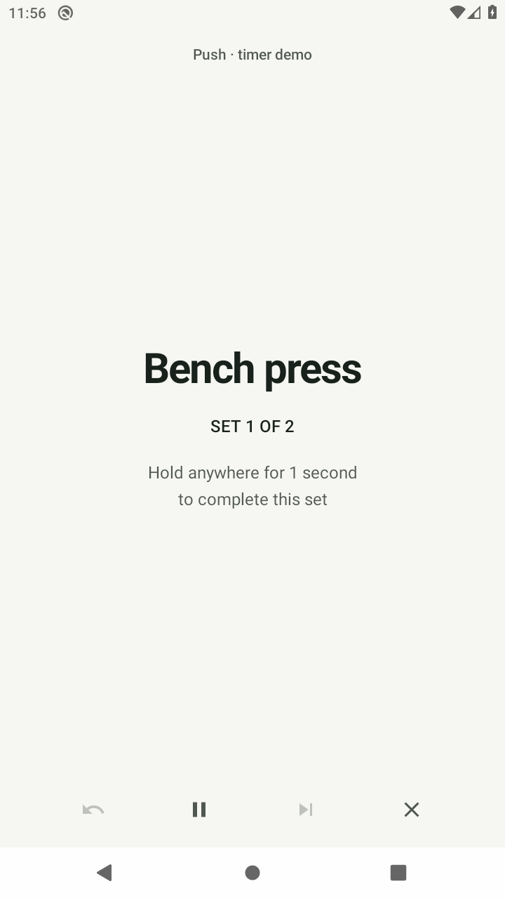
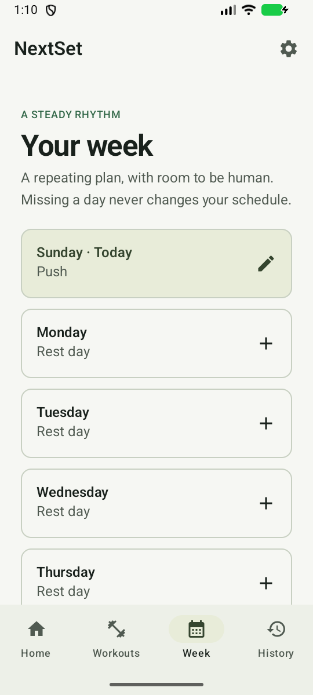

# NextSet

**A private, fully offline Android workout tracker.** Plan your week, build workouts around sets and rest, and train with a single one-second hold. No account, ads, analytics, subscriptions or cloud services.

Android **7.0+ (API 24)** · Kotlin · Jetpack Compose · Material 3 · Room · MIT

## Features

- Unlimited workout templates with editing, duplication, deletion and accessible reorder controls.
- Exercises with individual set counts and rest overrides, including the final set and zero rest. No weight or rep forms.
- Supersets with two or more movements, unequal set counts, and separate movement, round and post-group rest defaults.
- A repeating weekly schedule, today's assignment and clear rest days. Start any saved workout without shifting the plan.
- Minimal execution: hold for one second to complete a set; a deadline-based countdown turns red and waits for acknowledgment. Pause, resume, skip rest, undo and confirmed abandonment are available.
- Durable session recovery, immutable workout history, calendar/date browsing and actual completed-set records.
- Optional adaptive or manual daily reminders; completed scheduled workouts and active sessions suppress reminders.
- Light, dark and system themes, large-text support, accessible labels/actions and adaptive/themed launcher icons.

## Screenshots

Actual screenshots from the running app on an Android API 37 emulator. Workout names are demonstration data entered during testing; the app ships with an empty database.

<p>  </p>
<p>  </p>

## Run locally

1. Clone/download this repository and open its root folder in Android Studio.
2. Install **Android SDK Platform 37** and **Build Tools 36.0.0** through SDK Manager. Android Studio writes your ignored `local.properties` SDK path automatically.
3. Use the checked-in Gradle wrapper (**9.6**) and AGP **9.5.1**. The daemon configuration requests **JetBrains JDK 21**, which Gradle can provision automatically. The vendor requirement prevents Gradle from selecting editor runtimes that lack Android build tools such as `jlink`. App bytecode targets Java 17; core-library desugaring supports `java.time` on API 24–25.
4. Start an emulator or connect a development device with USB debugging enabled, then run:

```sh
./gradlew :app:assembleDebug
adb install -r app/build/outputs/apk/debug/app-debug.apk
adb shell am start -n com.sujoy.nextset/.MainActivity
```

Initial dependency/toolchain downloads need internet on the development machine. The installed app does not. Use a test device/emulator for development; a debug certificate cannot update an app signed with a different release certificate.

## Use NextSet

1. On first launch, select **Create your first workout**. Name it, add exercises or supersets, and adjust each movement's sets.
2. Set block rest defaults in minutes/seconds. **Customize rest for each set** overrides a default; zero skips that rest. The last set can have its own override. Use arrows to reorder blocks or superset movements, then **Save**.
3. In **Week**, tap a weekday and choose a template or **Rest day**. Assignments repeat weekly; missed workouts never shift them.
4. On **Home**, choose **Start workout**, select today's plan or any saved workout, review it, and start. Notification and precise-alarm access are optional.
5. Hold the main surface for one second to complete a set. Short taps do nothing. When rest turns red, hold again to continue. Secondary controls offer undo, pause/resume, skip rest and end. Accessibility custom actions offer an alternative to holding.
6. Leaving for Home preserves the session; **Resume workout** restores it. Ending saves an abandoned session. **History** shows actual training independently of the schedule.
7. **Settings** controls appearance, new-block default rest and optional workout reminders. Choose automatic timing or set a manual local time.

Specific set overrides take priority over block defaults. Within supersets, movements with no remaining sets drop out of later rounds. Configured rest after the final workout set is retained. Rest has no product-imposed maximum; storage represents non-negative Int seconds.

## Privacy and permissions

Room and DataStore use private local app storage. There is **no INTERNET permission**. Android cloud backup and device-transfer backup are excluded. Uninstalling or clearing storage removes data; export/import is not currently available.

| Permission | Purpose | User control |
| --- | --- | --- |
| Notifications (`POST_NOTIFICATIONS`) | Rest-complete sound/vibration and daily reminders | Runtime request on Android 13+; denial never blocks training |
| Alarms & reminders (`SCHEDULE_EXACT_ALARM`) | Precise background rest deadlines | Optional special access on Android 12+; otherwise alarms may be delayed |
| Vibration (`VIBRATE`) | Notification vibration and permitted feedback | Normal permission; device/channel settings still apply |
| Boot completed (`RECEIVE_BOOT_COMPLETED`) | Restore future alarms after reboot and unlock | Normal permission; no permanent wake lock or foreground service |

The AndroidX-generated non-exported receiver permission protects library receivers. No contacts, location, sensor, storage, DND-bypass or battery-exemption permissions are requested.

Reminders are off by default. Automatic timing uses up to 30 starts from the last 60 days, favors recent starts without letting a single outlier dominate, handles midnight, and defaults to 6 PM with fewer than three samples. Delivery follows the current local timezone and uses battery-friendly inexact alarms. Past reminders are not backfilled; one reminder is delivered per local date.

## Architecture

- **`domain/`** — validated models, repository contracts, shared set/rest planner, deterministic reducer and reminder policy.
- **`data/`** — normalized templates → blocks → exercises, schedule relations, immutable session snapshots, transactional execution checkpoints and completed sets, reminder delivery ledger and DataStore preferences.
- **`notifications/`** — monotonic clock adapter, serialized session runtime, permission-aware AlarmManager scheduling, receivers and notification channels.
- **`ui/`** — Compose screens, lifecycle-aware ViewModels/StateFlow, saved editor drafts and navigation. `NextSetApplication` wires dependencies; Activity hosts Compose and consumes notification intents.

Execution observes its checkpoint, session status and completed sets in one Room transaction. Template deletion clears schedule references without touching history. Session snapshots are independent of editable templates. Accepted execution transitions finish their persistence/alarm work even if their screen is removed.

Schemas **1–3** are committed in `app/schemas`. Migrations preserve existing records; no destructive fallback is enabled. [Execution and recovery policies](docs/EXECUTION.md) describe deadlines, pauses, reboot behavior and reminder learning.

## Test

```sh
./gradlew :app:assembleDebug :app:testDebugUnitTest :app:lintDebug
# Requires a running emulator/device:
./gradlew :app:connectedDebugAndroidTest
# Optimized, unsigned release:
./gradlew :app:assembleRelease
```

Reports: `app/build/reports/tests/testDebugUnitTest/`, `app/build/reports/androidTests/connected/debug/`, and `app/build/reports/lint-results-debug.html`.

See the [QA checklist](docs/QA.md) for automated coverage, audit fixes and device tests. No physical-device verification is claimed.

## Release

The release build enables R8 and resource shrinking and produces `app/build/outputs/apk/release/app-release-unsigned.apk`. It contains no debug signing configuration. Sign using **your own** protected keystore; this repository does not create or store release credentials.

Follow [the exact build, signing and upgrade steps](docs/RELEASE.md). Nothing is published automatically.

## Known limitations

- The interface is currently English. There is no export/import, cloud sync, history editing or reminder catch-up.
- Notification permission, channel preferences, alarm volume (or notification volume in Follow device settings), Do Not Disturb, idle quotas and manufacturer battery policies may suppress/delay alerts. Grant precise-alarm access for background rest timing. Force-stopped apps must be reopened; revoking exact-alarm access can cancel alarms until the next launch.
- Pauses freeze rest timers; elapsed workout duration includes pauses/background/device-off time. Across reboot plus a clock correction, exact timing reconstruction is impossible; recovery is bounded by the saved remainder.
- Automated device coverage uses the available API 37 emulator. API 24 hardware, physical audio/haptics, TalkBack and manufacturer power policies remain manual validation.
- Dependencies are pinned for the tested toolchain. Lint can report newer available versions and a third-party Lifecycle lint API compatibility warning; these are documented, not hidden by a baseline.

## Contribute and license

See [CONTRIBUTING.md](CONTRIBUTING.md). NextSet source and original assets, including its vector icon and short completion chime, use the [MIT License](LICENSE). Third-party dependencies retain their own licenses.
